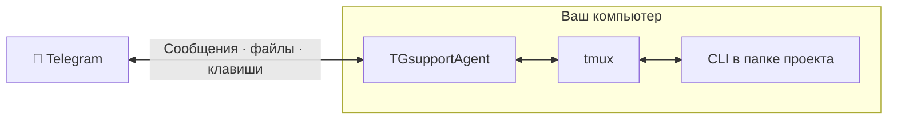

<div align="center">

# TGsupportAgent

**Ваш терминал — в Telegram.**

Запускайте CLI, отправляйте задания и управляйте сессиями с телефона.


**Codex · Claude · Kimi · agy · Bash · ваш CLI**

[Быстрый старт](#quick-start) · [Настройки](#configuration) · [Команды](#commands) · [Приватность](#privacy) · [Помощь](#troubleshooting)

</div>

---

Бот работает на вашем компьютере: запускает программы в отдельных сессиях **tmux**, пересылает текст терминала и принимает сообщения, файлы и нажатия клавиш из Telegram. CLI устанавливаются и авторизуются отдельно.



## Что умеет

| | Возможность | Как это работает |
| :---: | --- | --- |
| 📂 | **Проекты** | Выберите папку и CLI кнопками |
| 🖥 | **Сессии** | Переключайтесь между задачами и возвращайтесь после перезапуска бота |
| 📡 | **Вывод** | Читайте обновления терминала, открывайте экран и скачивайте лог |
| ⌨️ | **Управление** | Отправляйте Enter, стрелки, Tab, Esc и Ctrl+C |
| 📝 | **Задания** | Соберите сообщения, документы и фотографии в один запрос |
| ⚙️ | **Режимы** | Выберите компактный вывод, поток изменений или уведомления |
| 🔐 | **Личный доступ** | Управление доступно одному владельцу в личном чате |

## Требования

- Python 3.11 или новее.
- tmux.
- Linux или macOS; для Windows — окружение WSL.
- Telegram-бот и числовой ID владельца.
- Установленный CLI, которым вы хотите управлять.

> [!NOTE]
> Компьютер должен оставаться включённым и иметь доступ к Telegram. Бот использует long polling: публичный адрес и входящий порт не нужны.

<a id="quick-start"></a>

## Быстрый старт

### 1. Подготовьте окружение

Скачайте репозиторий и откройте его папку в терминале. Установите tmux подходящей командой:

```bash
# Debian / Ubuntu
sudo apt install tmux

# Arch Linux
sudo pacman -S tmux

# macOS с Homebrew
brew install tmux
```

Создайте виртуальное окружение и установите проект:

```bash
python3 -m venv .venv
source .venv/bin/activate
pip install -e .
cp .env.example .env
chmod 600 .env
```

### 2. Подключите Telegram

Создайте бота через **@BotFather** в Telegram. Заполните `.env` своими значениями:

```dotenv
TELEGRAM_BOT_TOKEN=YOUR_BOT_TOKEN
TELEGRAM_OWNER_ID=YOUR_NUMERIC_TELEGRAM_ID
CLI_PROFILES=profiles.json
POLL_SECONDS=2
PROJECTS_DIR=~/projects
```

`TELEGRAM_OWNER_ID` — положительный числовой ID вашего аккаунта, а не username или ID бота. Значения `YOUR_…` нужно заменить.

### 3. Запустите мост

Откройте личный чат с созданным ботом и нажмите **Старт**. Запустите мост из папки репозитория:

```bash
tg-cli
```

Бот отправит меню. Выберите **📂 Проекты**, папку и CLI либо используйте команду:

```text
/startcli codex demo-project
```

> [!TIP]
> Для проверки без установленного агента запустите `/startcli shell` и отправьте `echo hello`.

<a id="configuration"></a>

## Настройки

| Переменная | Назначение | По умолчанию |
| --- | --- | --- |
| `TELEGRAM_BOT_TOKEN` | Токен бота от BotFather | Обязательна |
| `TELEGRAM_OWNER_ID` | Числовой ID владельца | Обязательна |
| `CLI_PROFILES` | Путь к JSON с профилями CLI | `profiles.json` |
| `POLL_SECONDS` | Интервал чтения вывода в секундах, минимум 1 | `2` |
| `PROJECTS_DIR` | Общая папка с проектами | Без выбора проекта запуск в `~` |

В `.env.example` указан пример папки проектов. `/projects` показывает её непосредственные подпапки, пропуская скрытые папки и файлы. Новые папки появляются при следующем вызове команды. После изменения переменных или профилей перезапустите бота.

`/startcli` запускает Codex в домашней папке. Команда `/startcli codex demo-project` ищет проект внутри `PROJECTS_DIR`. Можно передать полный путь, а путь с пробелами заключить в кавычки:

```text
/startcli shell "~/projects/demo project"
```

Без выбора папки любой профиль запускается в домашней папке пользователя. Старое поле `cwd` в профилях не используется.

### Профили CLI

`profiles.json` содержит имя профиля и массив команды с аргументами:

```json
{
  "codex": {"command": ["codex"]},
  "claude": {"command": ["claude"]},
  "shell": {"command": ["bash"]},
  "custom": {"command": ["/opt/custom-cli/bin/custom-cli", "--verbose"]}
}
```

Аргументы задаются отдельными элементами массива. Shell-операторы и конвейеры в `command` не поддерживаются. Можно указать абсолютный путь к исполняемому файлу.

Бот ищет CLI в `PATH` и некоторых пользовательских каталогах установки, включая npm, nvm, fnm, Cargo и `~/.kimi-code/bin`. Установка самого моста не устанавливает CLI и не оформляет подписки на сервисы.

<a id="commands"></a>

## Команды Telegram

| Команда | Действие |
| --- | --- |
| `/start`, `/menu`, `/help` | Меню и справка |
| `/profiles` | Список профилей |
| `/projects` | Выбор проекта, затем CLI |
| `/cli` | Выбор CLI для запуска в домашней папке |
| `/startcli [профиль] [папка]` | Новая сессия |
| `/sessions` | Список сессий с кнопками выбора |
| `/switch имя` | Переключение на сессию по имени |
| `/resume` | Возврат к последней выбранной сессии |
| `/attach` | Текущий экран терминала |
| `/send текст` | Передача текста в CLI, включая команды со слешем |
| `/draft` | Начать составление задания |
| `/submit` | Отправить собранное задание |
| `/cancel` | Отменить черновик |
| `/settings` | Выбор режима вывода |
| `/log` | Скачать сохранённый терминальный текст |
| `/stop [имя]` | Завершить выбранную или указанную сессию |

Обычное сообщение отправляется в выбранный CLI с Enter. Для передачи команды самой программе используйте, например, `/send /help`. Так же можно отправить текст, совпадающий с названием кнопки меню. Кнопки клавиш от другой сессии отклоняются.

### Задания и файлы

Нажмите **✍️ Составить задание**, отправьте несколько сообщений или вложений, затем нажмите **📨 Отправить задание**. Черновик привязан к сессии и сохраняется после перезапуска. Максимальный размер текста — 100 000 байт.

Документы и фотографии до 20 МиБ сохраняются в `.tgbridge-uploads/` внутри исходной папки сессии. CLI получает подпись и локальный путь к файлу. Возможность прочитать файл или изображение зависит от CLI. Отмена черновика не удаляет загруженные файлы.

## Сессии и вывод

Сессии tmux переживают перезапуск бота, пока работает tmux-сервер. Перезагрузка компьютера их завершает. Остановка бота через Ctrl+C оставляет сессии запущенными; `/stop` завершает сессию и удаляет её локальный поток вывода. После выхода процесса CLI терминал сохраняется для просмотра результата.

Локальный список сессий:

```bash
tmux -L tgbridge list-sessions
```

Автоматически пересылается вывод только выбранной сессии. Режимы в `/settings`:

| Режим | Что приходит в чат |
| --- | --- |
| `compact` | Обновления объединяются в сообщения, анимации фильтруются |
| `full` | Текстовые изменения приходят отдельно, символы Брайля сохраняются |
| `notify` | Только уведомления; экран доступен через `/attach` |

<details>
<summary><strong>Как устроены запись и доставка вывода</strong></summary>

Бот читает поток через `tmux pipe-pane` и разбирает терминальные управляющие последовательности. Это текстовое представление терминала: перерисовки и спиннеры фильтруются приблизительно. `/log` экспортирует сохранённый терминальный текст, а не полную историю диалога агента. Для существующей сессии запись подключается при её выборе; более ранний вывод доступен лишь в пределах сохранённого экрана.

Локальные данные находятся в `.tgbridge-output/` рядом с исходниками: состояние, черновик, очередь доставки и два сегмента исходного потока на сессию примерно по 8 МиБ. Старые сегменты заменяются при ротации. При длительной недоступности Telegram часть вывода может быть утрачена; после сетевого сбоя возможна повторная доставка сообщения. Ограничения Telegram замедляют доставку.

Запросы подтверждения определяются приблизительно по тексту экрана. Статус «работает» означает, что процесс жив; уведомление о завершении означает выход CLI, а не окончание каждого ответа модели. Пересылка вывода сама по себе не вызывает модель; отправленные задания используют лимиты выбранного CLI обычным образом.

</details>

<a id="privacy"></a>

## Доступ и приватность

Бот принимает сообщения и нажатия кнопок только от указанного владельца в личном чате. Владелец управляет CLI с правами пользователя компьютера; профиль `shell` позволяет выполнять команды с этими правами. Запускайте мост без прав root.

> [!IMPORTANT]
> Переписка с Telegram-ботами не имеет сквозного шифрования. Текст терминала и отправленные файлы проходят через Telegram. Не публикуйте `.env`, локальное состояние, журналы и загруженные файлы.

Перед отправкой вывода и экспортом лога бот маскирует известные значения переменных окружения с `TOKEN`, `SECRET`, `PASSWORD` или `API_KEY` в имени, если значение содержит не менее шести символов. Это не гарантирует удаления всех секретов. Исходный поток и локальные файлы могут содержать данные без маскирования. При утечке токена замените его через BotFather.

<a id="troubleshooting"></a>

## Решение проблем

| Проблема | Что проверить |
| --- | --- |
| Бот не отвечает | Токен, числовой ID владельца, личный чат и нажатие «Старт» |
| CLI не найден | Установку CLI, `PATH` или абсолютный путь в профиле |
| Не видны проекты | Существование `PROJECTS_DIR` и непосредственных подпапок |
| Команда `/help` открывает справку бота | Для справки CLI отправьте `/send /help` |
| Нет вывода | Выбранную сессию, режим `/settings` и снимок `/attach` |
| Ошибка чтения профилей | Запуск из папки репозитория или абсолютный `CLI_PROFILES` |

## Разработка

После установки зависимостей запустите тесты:

```bash
python -m unittest discover -s tests -v
```

Тесты не требуют токена личного Telegram-бота. Для проверки реального подключения запустите профиль `shell`, проверьте отправку текста, клавиши, переключение сессий и `/stop`.
